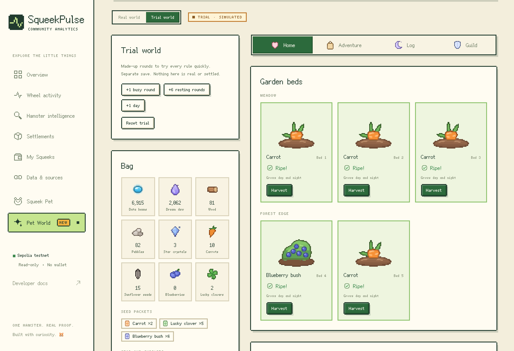
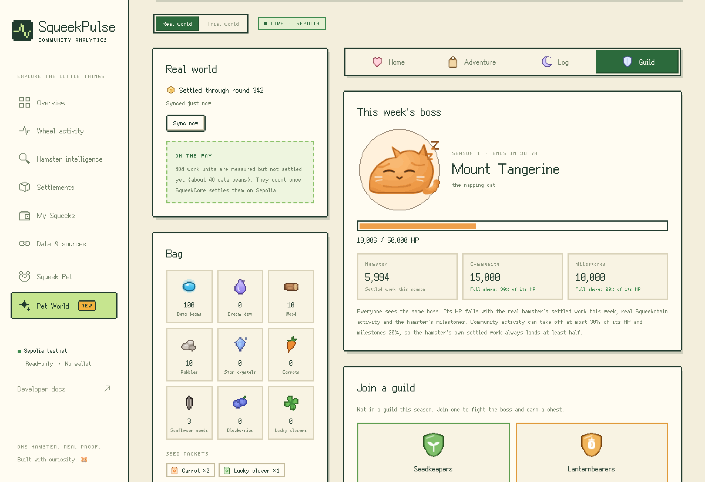

# Squeek Pet

[中文说明](README.zh-CN.md)

A desktop hamster that moves with **Squeektoshi's real hamster wheel** on SqueekChain (Sepolia testnet).

When the real wheel turns, the pet wakes up and runs at the wheel's measured RPM. New measured work turns into glowing blue data beans that pile up beside the wheel; when the run ends, the pet eats them and burps the exact total. Settled Squeek Blocks pop a gold block. When the data is late or missing, the pet hugs a question mark instead of pretending to sleep.

Normally there is only a small hamster in the corner of the screen. Hover it for a status bubble, double-click for a mini panel.

New: **[Squeek Pet World](#squeek-pet-world)**, a little web game at [squeekpulse.xyz/world](https://squeekpulse.xyz/world/) with a home, adventures and a guild. It moves only when the real hamster's work is settled on chain. Only the pet is a desktop app; the game is played in the browser, and from the next release the pet's menu opens it.


> Status: **MVP, version 0.1.2.** On Windows, [download the installer](#windows). On macOS and Linux, [build it from source](#install-from-source), which takes a few minutes. Built and launched on Linux, on an Apple Silicon Mac and on a Windows machine at GitHub. How it looks on real desktops is only partly checked — see [What has been verified](#what-has-been-verified).

## How the real wheel drives the pet

Everything comes from one read-only request, `GET https://api.squeekchain.com/v1/status` (schema version 1), polled every 2 to 10 seconds depending on the performance setting.

The "Live on X" button is the one exception: when it appears it also reads Squeek Chain's live descriptor, `https://media.squeekchain.com/live/current.json`, at most every 30 seconds (see [Watching the live stream](#watching-the-live-stream)). Squeek Pet World is a web page, so it reads the API in your browser, not through the pet; see [Squeek Pet World](#squeek-pet-world).

| API field | What the pet does |
| --- | --- |
| `measurement.coreStatus` = `ACTIVE` | Wakes up (eyes, ears, shake), hops onto the wheel and runs side-on, looking ahead along the wheel. |
| `measurement.coreStatus` = `IDLE` | Hops off, eats any beans, then lies down in the nest. Hover shows `Zzz…` and "the wheel is still" (a still wheel does not prove the hamster is asleep, and the bubble says so). |
| `measurement.coreStatus` = `COUNTER_FAULT` | Dizzy eyes and a "sensor fault" bubble. |
| `measurement.rpmMilli` | Wheel spin and stride speed, smoothed. Speed lines above about 55 RPM. |
| `measurement.cumulativeWorkUnits` + `counterEpoch` | New work becomes beans (configurable, default 10 work units per bean). A new epoch or a counter that goes backwards only re-baselines; nothing is counted twice and work done before launch is not counted. |
| `measurement.freshness`, `receivedAt`, `staleAfterSeconds` | Older than `staleAfterSeconds` (120 s) or `stale` → offline pet with a question mark, never sleep. Uses the server clock (`generatedAt`) so a wrong local clock does not matter. |
| `measurement` = `null` | Offline: "the API has no wheel reading yet". |
| `measurement.provenance` ≠ `hardware` | The pet always wears a label (SIMULATED, REPLAY, DERIVED). |
| `builder.anchor.blockHeight` | A rise in the **settled** height plays the gold-block celebration and links the transaction. `builder.projected` is never used. |
| HTTP 429 / 503 | Waits for `Retry-After`, otherwise backs off exponentially (up to 60 s). |
| `schemaVersion` ≠ 1 | Stops and asks for an update instead of guessing. |

Requests are plain GETs, so the browser engine sends no CORS preflight. Conditional requests (`If-None-Match`) are not used, because they would trigger a preflight; the API's 1-second shared cache keeps polling cheap. Because of that, a 304 cannot happen.

### Pet states

`loading → sleeping ⇄ waking → running → stopping → eating → sleeping`, plus `offline` and `fault`, which can interrupt any state. The real wheel decides the state; user interactions are short overlays that never change it. A settled-block celebration plays on top of whatever the pet is doing, then it carries on.

### Interactions

| You | The pet |
| --- | --- |
| Hover | Looks at the pointer, shows the status bubble (and `Zzz…` when asleep). |
| Hover while the real hamster runs | A "Live on X" button appears beside the wheel; click it to watch @squeekchain's live stream. |
| Move the pointer nearby | Eyes follow it. |
| Click | Blinks, a little note, squeaks if sounds are on. |
| Four quick clicks | Gets grumpy for a moment. |
| Rub back and forth over the head | Happy eyes and a heart (head pat). |
| Drag | Moves the pet; the position is remembered, including on a second screen. |
| Double-click | Mini panel: wheel, speed, today's distance, measured work, work since launch, settled blocks with a transaction link. |
| Right-click | Menu: details, Squeek Pet World (opens the web game in your browser), size (50% to 150%, or a custom size in Settings), sounds, demo mode, Squeek Pulse, settings, hide, quit. |
| Tray / menu bar icon | Show or hide, details, Open Squeek Pet World (in your browser), demo mode, settings, quit. |
| Browser page (Pat / Feed / Wake) | The hosted build adds three buttons, or press `P`, `F` or `W`. Pat gives a heart, Feed gives a small treat, Wake stretches without changing the wheel state. Presentation only. |

Everything outside the hamster, wheel and nest is click-through, so the pet never blocks the apps underneath.

### Watching the live stream

[@squeekchain](https://x.com/squeekchain) streams Squeektoshi's wheel on X, and every stream gets a new address. While the real hamster runs (live hardware data only, never demo, simulated or replayed data), hovering the pet shows a "Live on X" button beside the wheel.

- If Squeek Chain's live descriptor says an X broadcast is live, the button opens that broadcast (`x.com/i/broadcasts/…`) directly.
- Otherwise it opens the [@squeekchain profile](https://x.com/squeekchain), one click away from the current stream.

The descriptor currently answers only squeekchain.com's own origin, so for now the button always opens the profile. It switches to the direct broadcast link by itself once Squeek Chain allows the app's origins (`tauri://localhost` on macOS and Linux, `http://tauri.localhost` on Windows); no new release is needed.

On the desktop, status bubbles and the details panel live in a separate transparent window. They appear above the pet when there is room, and below it near the top of the screen. The pet no longer reserves empty space for a bubble, so it can be dragged to the top edge. Cards stay within the current screen's work area; a tall details panel scrolls when space is limited.

### Settings

Language (English / 中文, defaults to the system language), pet size (a slider from 40% to 150% in 5% steps, 75% by default; below 80% only the pet shrinks, so bubbles and the panel stay readable), animation performance (Eco 15 fps / Balanced 30 fps / Smooth 60 fps, which also sets the poll interval), work units per bean, always on top, launch at startup, sounds (off by default), activity notifications, and demo mode.


### Demo mode

A scripted 60-second loop for trying the animations while the real hamster rests. Demo data is labelled `DEMO` on the pet and in every bubble, never links a transaction, and runs in a separate state machine, so it can never mix with live totals.

## Squeek Pet World

A little world that grows with the real hamster: a home with garden beds and buildings, adventures, a log of every round, and a guild that fights a weekly boss together with everyone else. It moves only when SqueekCore settles a round of Squeektoshi's work on Sepolia, about every ten minutes, so no amount of clicking can speed it up.

It is a web game at **[squeekpulse.xyz/world](https://squeekpulse.xyz/world/)**, a page of the Squeek Pulse site, in English and Chinese, on computers and phones. Open it in any browser, or from the pet's right-click menu or tray (**Open Squeek Pet World**). Only the pet is a desktop app. The game's code lives in this repository (`src/world/`) and is built into one script for the site with `npm run build:world` (see [For developers](#for-developers)). It draws in the site's pixel style: its drawings are turned into pixel art in the browser, and it uses the site's fonts and colours.



| Tab | What you do |
| --- | --- |
| Home | Plant crops in the garden beds and harvest them, build and upgrade eight buildings, unlock new areas. |
| Adventure | Pick one of five routes, up to two pieces of gear, a snack or a charm. Settled work walks the trip forward; choose a path at the fork and bring home what you found. |
| Log | What every settled round gave, with a link to its Sepolia transaction, and the world's diary. |
| Guild | Join one of four guilds for the season, pick a class, plan your move against the weekly boss, then open the season's chest. |
| Stake, Town | On chain (Sepolia), once the contracts are deployed: see below. |

**How it stays honest**

- One turn is one settled SqueekCore batch: a `system.settlement_completed` event in `GET /v1/events?category=protocol`, once it has 12 confirmations. A busy round pays 1 data bean per 10 settled work units, plus building bonuses. A resting round, with no work, gives dream dew. Crops grow with work, with rest, or with both, depending on the plant.
- Every settled turn pays once. A new world starts on the newest settled round and is not paid for the rounds before it. Rounds the feed no longer reaches become a marked gap that gives nothing, and a reorganised settlement is replaced and replayed.
- The world on screen is always replayed from the settled turns and your choices, so a number edited in storage can't turn into progress.
- Data beans exist only in your browser. They are free, can't be bought or sold, and are not a token. SQB, the World's token on Sepolia, is separate: see [On chain](#on-chain-sepolia-testnet).
- The save stays in this browser's local storage. **Export save** and **Import save** copy it as text, for a backup or another browser.
- Nothing runs while no World tab is open. Opening the page catches up on about the last two weeks of settled rounds (up to 40 pages of the event feed, read with pauses to stay inside the API's rate limit). Rounds older than that become a marked gap that gives nothing.
- The **trial world** runs on made-up rounds so every rule can be tried in minutes (+1 busy round, +6 resting rounds, +1 day). It has its own save and always shows **TRIAL · SIMULATED**; nothing in it is real or settled.

**The weekly boss**

Seasons start every Monday at 12:00 UTC. Everyone fights the same boss, and each browser works out its HP from public data on its own, with no game server: the hamster's settled work this season (`GET /v1/settlements?range=30d`), community activity on SqueekChain such as NFT deposits, merges and staking (`GET /v1/events?category=players`), and the hamster's milestones (`GET /v1/events?category=measurement`). Community activity can take off at most 30% of the boss's HP and milestones at most 20%, so the hamster's own work always does at least half. Beating the boss upgrades the season's chest one tier.



### On chain (Sepolia testnet)

Once its contracts are deployed and the site passes their addresses in, the World asks players to connect a wallet and adds two tabs. Everything is on the Sepolia testnet; no real money is involved. Each turn of the game stays free and off-chain; only assets and the economy go on chain.

| Tab | What you do |
| --- | --- |
| Stake | Stake testnet SQK to earn **SQB**: every 10 work units the hamster settles become 1 SQB, paid by the second over 24 hours to everyone staked, in proportion to their stake. Claim it whenever you like; unstake any time. A faucet gives new players 1,000 test SQK a day. |
| Town | Buy one of 100 numbered home deeds (an NFT, paid in SQK, each 1% dearer than the last), name it, renovate it with SQB, and place it in your world as an extra garden bed. Buy the season's decorations with SQB. |
| Guild | Your season's guild is recorded on chain. Send SQB supplies to the weekly boss (10 damage each, on top of the shared HP) for your guild's place on the supplies leaderboard, or found a player guild with SQK. |

Every SQK and SQB spent is burned; there is no treasury. SQB has no premine: it exists only once the hamster works and someone has staked. The game page never sees a key: it reads Sepolia through a public node, every transaction is simulated first and then shown in your wallet, and approvals use one-off signed permits where the wallet supports them. Each wallet has its own world in the browser. The contracts and the deploy page are in [`contracts/`](contracts/README.md).

The pet itself stays about the real wheel: its bubble and toasts don't show the World.

## Safety and privacy

- The pet is read-only: it reads only public endpoints (the status API, and the live descriptor while the "Live on X" button shows). No wallet connection, no private keys, no signing, no transactions.
- Squeek Pet World, in the browser, also reads the public event feed and settlement summaries. Its on-chain part (Sepolia testnet only) connects your browser wallet; the page never sees a key, and every transaction and signature is shown in your wallet first.
- No accounts, analytics or personal data. Settings stay in local storage on the device.
- Links open only Squeek Pulse, the SqueekChain docs, the Sepolia explorer (`eth-sepolia.blockscout.com`) and @squeekchain's live stream on X (`x.com/squeekchain` and `x.com/i/broadcasts/…`), enforced by the app's capability file.
- API values reach the screen only as text, never as HTML.

## Windows

1. Open the [latest release](https://github.com/zakehowell/squeek-pet/releases/latest) and download the file ending in `-setup.exe` (the `.msi` works too). For 64-bit Windows 10 and 11.
2. Run it. The installers are not code-signed, so the first time Windows SmartScreen says "Windows protected your PC": click **More info**, then **Run anyway**.
3. The hamster appears above the taskbar in the bottom-right corner. Its menu is the Squeek Pet icon in the notification area (click `^` if Windows hides it there). Uninstall it from Settings → Apps.

The installers are built by [GitHub Actions](.github/workflows/release.yml) from the source in this repository, at the commit the release points to; nobody builds them by hand. To check a download, compare it with `SHA256SUMS.txt` in the release, or run `gh attestation verify <file> --repo zakehowell/squeek-pet`.

If Windows 11's Smart App Control is on, it blocks unsigned apps outright and offers no "Run anyway", so the installer won't run there.

## Install from source

You build the app on your own computer. An app you build yourself is not quarantined, so macOS opens it without the "unidentified developer" warning.

**1. Install the tools once**

- [Node.js](https://nodejs.org/) 20.19 or newer.
- [Rust](https://www.rust-lang.org/tools/install) (stable), via rustup.
- macOS: Xcode Command Line Tools, `xcode-select --install`.
- Linux: the WebKitGTK packages listed in the [Tauri prerequisites](https://v2.tauri.app/start/prerequisites/).
- Windows: the Microsoft C++ Build Tools with "Desktop development with C++", and WebView2 (already part of Windows 11 and of up-to-date Windows 10), as in the [Tauri prerequisites](https://v2.tauri.app/start/prerequisites/). Most people should use the [installer](#windows) instead.

**2. Download and build**

```bash
git clone https://github.com/zakehowell/squeek-pet.git
cd squeek-pet
npm ci
npm run desktop:build
```

The first build downloads and compiles the Rust crates, so allow a few minutes. On an Apple Silicon Mac a release build took about 80 seconds. On a Mac, `npm run desktop:build -- --bundles app` builds only the app and skips the `.dmg`.

**3. Open it**

- macOS: `src-tauri/target/release/bundle/macos/Squeek Pet.app`. Drag it into Applications. A `.dmg` is in `src-tauri/target/release/bundle/dmg/`.
- Linux: the packages are in `src-tauri/target/release/bundle/` (`deb`, `rpm`, `appimage`).
- Windows: the installers are in `src-tauri\target\release\bundle\nsis\` and `msi\`.

The pet appears in the bottom-right corner of the screen. Quit it from the tray or menu-bar icon.

To update later: `git pull`, then `npm ci` and `npm run desktop:build` again.

### For developers

```bash
npm test               # unit tests (state machine, API parsing, ledger, texts)
npm run typecheck      # strict TypeScript, app and tests
npm run dev            # browser preview at http://127.0.0.1:1420 (?demo=1, ?lang=zh)
npm run desktop        # the real desktop pet, in development mode
```

`http://127.0.0.1:1420/preview.html` shows every pose side by side, replayed through the real state machine. `http://127.0.0.1:1420/world.html` runs Squeek Pet World on a bare page (`?mode=trial`, `?tab=guild`, `?lang=zh`).

`npm run build:world` builds the World for the site: one script, `dist-world/squeek-world.js`, whose `mountWorld(element, { language, chain })` draws the game inside the element's shadow root, so the page's styles and the game's never mix. `chain` is the World config the deploy page prints (the contracts' addresses and a public Sepolia node); without it the World stays read-only. Squeek Pulse keeps a copy as `src/vendor/squeek-world.js`; its first line names the commit it was built from, and the site's build keeps that line at the end of the deployed `world.js`, so you can check which commit is live.

The contracts, their tests and the deploy page are in `contracts/` ([contracts/README.md](contracts/README.md)). `npm run deploy:page` serves the deploy page at `http://127.0.0.1:1420/contracts/deploy/`. To play the on-chain World locally, run a fork of Sepolia (`npm run node:fork` and `npm run local:deploy` in `contracts/`) and open `world.html?chain=local`.


Nothing is code-signed. The Windows installers trigger SmartScreen the first time, as described [above](#windows). If you copy a Mac app you built to someone else's computer, macOS blocks it the first time (on macOS 15 and later, System Settings → Privacy & Security → Open Anyway; on earlier versions, right-click → Open). Building from source on each computer avoids this.

## What has been verified

| Check | Result |
| --- | --- |
| Unit tests (Vitest) | 193 passing. For the pet: API parsing and validation, Retry-After, backoff, state machine transitions, bean ledger (epochs, resets, caps), offline and clock-skew rules, demo loop, bubble and panel texts in both languages, settings and the pet size layout, the parts of the hamster drawing that the animation needs, the head turning to profile while running, the Wake and Feed reactions, which leave the data untouched, and the live stream descriptor. For Squeek Pet World (64): strict reading of the settlement feed, every settled turn paid exactly once, the same world on every replay, gaps, reorganisations and a new deployment, catching up after being closed (paced, about two weeks back), export and import, the shared boss's sums, caps, paging and partial reads, the trial world's separate save, turning drawings into pixel art, the tab keys, and every text in both languages. For the on-chain World and the deploy page (36): the ABI encoder and decoder, reading amounts, the chain config, the live SQB counter, contract errors, names as the shop checks them, deed beds, one world per wallet, guild-war supplies on the boss, the deploy plan and every text in both languages. Plus 8 Rust tests. |
| Contract tests (Hardhat) | 46 passing on Hardhat's own chain: minting from settled work and its limits and pauses, staking and claiming by the second, permits, deeds, renovations, decorations, guilds and supplies, the faucet, ownership, and that the exported ABIs are current. Plus 3 against the real SqueekCore and SQK on a fork of Sepolia, including minting SQB from a real settlement replayed from its original transaction. |
| Type checks | `tsc` strict, app and tests. |
| Live API | Pet page read the real `/v1/status` on 2026-10-31 (wheel idle, work 62,576, settled block #5,570) and showed it correctly in both languages. |
| Animations | Every state captured frame by frame through the demo loop. |
| Desktop build on Linux | `cargo build` and `clippy` clean; the app launched on a virtual X display, placed itself bottom-right and showed the sleeping pet on live data (Linux WebKit, the same engine family as macOS). |
| Desktop build on macOS | On an Apple Silicon Mac (macOS 26.6): the unit tests and type checks passed, `npm run desktop` compiled in about a minute and launched with no errors, and on 2026-11-01 a release build produced the `.app` (4.1 MiB) and `.dmg` (2.9 MiB) in 79 seconds. The same day a fresh clone of this repository went through `npm ci`, the tests, the type checks and an app-only build in 89 seconds. |
| Desktop build on Windows | On 2026-11-02 GitHub Actions built this repository on Windows Server 2025 (build 26100, the same build as Windows 11 24H2): the 81 unit tests passed, and a 4 min 34 s release build produced the `-setup.exe` (1.3 MiB) and the `.msi` (1.9 MiB). The `-setup.exe` installed silently, the pet started and was still running 30 seconds later, and a screenshot showed the sleeping hamster above the taskbar in the bottom-right corner, with the desktop visible through its transparent window. This check runs again for every change. |
| Squeek Pet World | In Chromium, on a local copy of squeekpulse.xyz with the live site's styles and fonts and the `/world/` page: English and Chinese, 1440, 1200, 1024, 800 and 390 px wide, no sideways scrolling; the trial world played through six simulated days; the keyboard (focus kept across redraws, arrow keys on the tabs, dialogs that keep and return focus); and on 2026-11-06 the real world founded itself on the newest settled round and read the shared boss live from the API (19,006 of 50,000 HP left). |
| Squeek Pet World on chain | On 2026-11-06, in Chromium against a local fork of Sepolia, in English and Chinese: the deploy page deployed all six steps from a test wallet (including a declined signature, a reload halfway, and a reload while a transaction waited for a block, which was waited for and not sent again) and its checks passed; the World then ran on those contracts: faucet, staking with a permit, a real settlement replayed and counted, claiming SQB, buying, naming, renovating and placing a deed, a decoration through the approve fallback, joining a guild on chain, supplies on the boss, founding a guild, a declined unstake, switching networks, and disconnecting. |
| **Not verified yet** | On macOS, what the pet looks like on screen: transparency over the desktop, click-through, drag and the menu bar icon. On Windows, anything done by hand: click-through, drag, the menus and tray icon, bubbles and the details panel, SmartScreen on a real PC, installing from the `.msi`, and Windows 10. Multi-monitor and mixed DPI. Autostart. Squeek Pet World on the deployed squeekpulse.xyz, in Safari and Firefox, and on real phones. The contracts on the real Sepolia (not deployed yet), with real wallets such as MetaMask. |

## Project layout

```
src/core/        API client, schema validation, poller, state machine, demo loop, settings, i18n
src/pet/         director (state → pose each frame), bubble/panel/toast texts, HUD
src/art/         the hamster drawing, the SVG scene around it, and the rig that animates them
src/world/       Squeek Pet World: the rules as data, the turn engine, feed and ledger, saves, shared boss, texts, art, pixel art and tabs
src/world/chain/ the World on Sepolia: reads, the wallet, permits, transactions and their errors (no dependencies)
contracts/       the SQB token, the minter, the World shop and the SQK faucet (Hardhat), and the deploy page
src/platform/    the only place that talks to the desktop shell
src-tauri/       Rust shell: transparent window, click-through, tray, settings window
world.html       a bare page for working on Squeek Pet World (src/world-dev.ts)
vite.world.config.ts   builds the World into one script for squeekpulse.xyz/world
tests/           Vitest suites, with captured live API responses and event feed pages
```

## Recording a demo

The strongest 15-second clip shows three moments: the real wheel starts and the pet wakes and runs; the run produces beans that fly into the dish; the wheel stops and the pet eats, burps the total, and lies down with `Zzz…` on hover.

1. Put Squeek Pet on a clean desktop at 100% size or larger and turn on sounds.
2. Open [Squeek Pulse](https://squeekpulse.xyz/) next to it, so viewers can see the same live reading.
3. Record when Squeektoshi is active. If the hamster is resting, use demo mode for rehearsal only, and keep the DEMO label visible in anything you publish.

## Not in this version

Recording clips from the app, a do-not-disturb mode for full-screen apps, random idle wandering, extra skins, and OS-level notifications. For Squeek Pet World: leaderboards other than guild supplies, and the contracts on mainnet (Sepolia only for now).

## License

Squeek Pet's code and artwork, including the hamster, the wheel, bowl and bed around it, and the app icon, are original and licensed under [MIT](LICENSE). No SqueekChain artwork is included. SqueekChain names, trademarks, documentation and API remain subject to their owners' terms and are not relicensed here.
