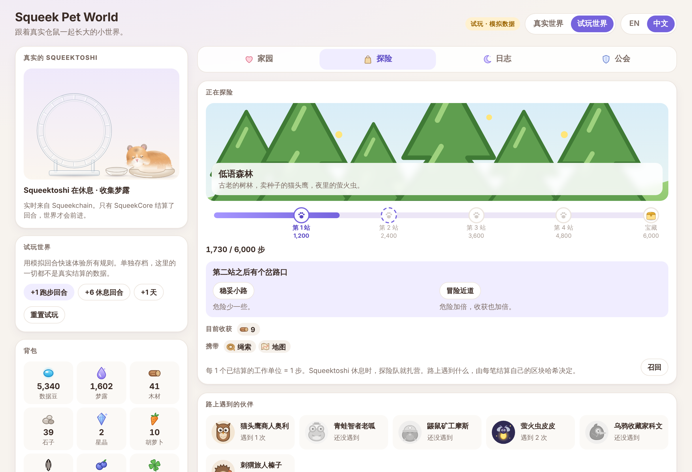

# Squeek Pet

[English](README.md)

一只住在你桌面上的仓鼠，和 SqueekChain（Sepolia 测试网）上 **Squeektoshi 的真实跑轮**同步。

真实跑轮转起来，它就醒来，按真实转速奔跑。新测到的工作量会变成蓝色数据豆堆在跑轮旁边，跑完它会把豆子吃掉，再打个嗝报出准确的总数。链上结算出新的 Squeek 区块时，会冒出一个金色方块。数据过期或拿不到时，它会抱着问号等着，不会假装在睡觉。

平时它只是屏幕角落里的一只小仓鼠。鼠标移上去能看状态气泡，双击打开迷你面板。

新功能（0.1.2 安装包里还没有）：**[Squeek Pet World](#squeek-pet-world)**，一个有家园、探险和公会的小世界，只有真实仓鼠的运动量在链上结算后才会往前走。


> 状态：**MVP，版本 0.1.2。** Windows 可以直接[下载安装包](#windows)；macOS 和 Linux 需要[从源码编译](#从源码安装)，几分钟就好。已经在 Linux、Apple 芯片的 Mac 和 GitHub 的 Windows 机器上编译运行过。

## 安全和隐私

- 只读：主要只访问一个公开接口 `GET https://api.squeekchain.com/v1/status`；「在 X 看直播」按钮出现时，还会读一下 Squeek Chain 的直播描述文件 `https://media.squeekchain.com/live/current.json`（最多 30 秒一次）；Squeek Pet World 还会读同一个 API 的公开事件流和结算汇总。不连钱包，不碰私钥，不签名，不发交易。
- 没有账号、没有统计、不收集个人数据。设置只保存在你自己的电脑上。
- 只会打开 Squeek Pulse、SqueekChain 文档、Sepolia 区块浏览器和 @squeekchain 的 X 直播链接。

## Windows

1. 打开[最新版本](https://github.com/zakehowell/squeek-pet/releases/latest)，下载文件名以 `-setup.exe` 结尾的安装包（`.msi` 也可以）。适用于 64 位 Windows 10 和 11。
2. 双击运行。安装包没有代码签名，第一次运行时 Windows 会提示「Windows 已保护你的电脑」，点「更多信息」，再点「仍要运行」。
3. 装好后，仓鼠会出现在右下角任务栏上方。菜单在通知区域的 Squeek Pet 图标里（如果被收起来了，点 `^`）。卸载：设置 → 应用。

安装包由 [GitHub Actions](.github/workflows/release.yml) 用本仓库的源码、在这个版本对应的提交上自动编译，没有人手动编译过。想核对下载的文件，可以和版本页里的 `SHA256SUMS.txt` 对比，或者运行 `gh attestation verify <文件> --repo zakehowell/squeek-pet`。

如果 Windows 11 打开了「智能应用控制」，它会直接拦下没有签名的程序，没有「仍要运行」，这种电脑上暂时装不了。

## 从源码安装

在自己电脑上编译出来的 app 不会被 macOS 拦截，打开时不会提示"无法验证开发者"。

**1. 先装好工具（只需要装一次）**

- [Node.js](https://nodejs.org/) 20.19 或更新版本。
- [Rust](https://www.rust-lang.org/zh-CN/tools/install)（stable 版，用 rustup 安装）。
- macOS：Xcode 命令行工具，在终端运行 `xcode-select --install`。
- Linux：按 [Tauri 环境说明](https://v2.tauri.app/zh-cn/start/prerequisites/) 安装 WebKitGTK 等依赖。
- Windows：按 [Tauri 环境说明](https://v2.tauri.app/zh-cn/start/prerequisites/) 安装 Microsoft C++ 生成工具（勾选「使用 C++ 的桌面开发」）和 WebView2（Windows 11 和更新过的 Windows 10 已自带）。一般人直接用[安装包](#windows)就好。

**2. 下载并编译**

```bash
git clone https://github.com/zakehowell/squeek-pet.git
cd squeek-pet
npm ci
npm run desktop:build
```

第一次编译要下载 Rust 依赖，需要几分钟。在 Apple 芯片的 Mac 上，正式版编译大约 80 秒。在 Mac 上只想要 app、不要 `.dmg` 的话，最后一步改成 `npm run desktop:build -- --bundles app`。

**3. 打开**

- macOS：`src-tauri/target/release/bundle/macos/Squeek Pet.app`，拖进"应用程序"文件夹即可。`src-tauri/target/release/bundle/dmg/` 里还有一个 `.dmg`。
- Linux：安装包在 `src-tauri/target/release/bundle/` 里（deb、rpm、appimage）。
- Windows：安装包在 `src-tauri\target\release\bundle\nsis\` 和 `msi\` 里。

仓鼠会出现在屏幕右下角。从托盘或菜单栏图标可以退出。

以后更新：先运行 `git pull`，再运行一次 `npm ci` 和 `npm run desktop:build`。

所有安装包都没有代码签名。Windows 安装包第一次运行会弹出 SmartScreen 提示，处理方法见[上面](#windows)。如果把自己编译的 Mac app 直接拷给别人，对方第一次打开会被 macOS 拦下（macOS 15 及以后：系统设置 → 隐私与安全性 → 仍要打开；更早的版本：右键 → 打开）。让每个人在自己电脑上从源码编译，就没有这个问题。

## 怎么和它玩

| 你 | 仓鼠 |
| --- | --- |
| 鼠标移上去 | 看着你，显示状态气泡（睡觉时显示 `Zzz…`） |
| 真实仓鼠在跑时鼠标移上去 | 跑轮右边出现「在 X 看直播」按钮，点一下就去看 @squeekchain 的直播 |
| 鼠标在附近移动 | 眼睛跟着转 |
| 单击 | 眨眨眼；打开声音时会吱一声 |
| 快速连点四下 | 生一会儿气 |
| 在头上来回蹭 | 眯眼开心，冒出爱心 |
| 拖动 | 换个位置，会记住 |
| 双击 | 迷你面板：跑轮状态、转速、今天的距离、测到的工作量、结算区块和交易链接 |
| 右键 | 菜单：详情、Squeek Pet World、大小、声音、演示模式、Squeek Pulse、设置、隐藏、退出 |
| 托盘 / 菜单栏图标 | 显示或隐藏、详情、打开 Squeek Pet World、演示模式、设置、退出 |

设置里可以改：语言（中文 / English，默认跟随系统）、大小（40% 到 150%，默认 75%）、动画流畅度（省电 15 帧、均衡 30 帧、流畅 60 帧，也决定读取频率）、每颗豆子代表的工作量、置顶、开机启动、声音（默认关闭）、活动通知和演示模式。演示模式始终标着 `DEMO`，不会和真实数据混在一起。

桌面版的状态气泡和详情面板使用独立的透明窗口：上方空间足够时显示在上面，宠物靠近屏幕顶部时自动显示在下面。气泡不再占用宠物窗口的空白区域，因此可以把宠物拖到顶部。卡片会避开当前屏幕的菜单栏和 Dock，空间不足时详情内容可以滚动查看。

## 看直播

[@squeekchain](https://x.com/squeekchain) 会在 X 上直播 Squeektoshi 的跑轮，每场直播的链接都不一样。只有真实仓鼠在跑时（真实硬件数据；演示、模拟、回放数据都不会出现），鼠标移到仓鼠上，跑轮右边才会出现「在 X 看直播」按钮。

- 如果 Squeek Chain 的直播描述文件显示 X 上正在直播，按钮直接打开那一场直播（`x.com/i/broadcasts/…`）。
- 否则打开 [@squeekchain 主页](https://x.com/squeekchain)，从主页再点一下进入当前直播。

这个描述文件目前只对 squeekchain.com 自己开放，所以现在按钮总是打开主页。等 Squeek Chain 允许本应用的来源（macOS 和 Linux 是 `tauri://localhost`，Windows 是 `http://tauri.localhost`）之后，按钮会自动改成直接打开直播，不需要发新版本。

## Squeek Pet World

一个跟着真实仓鼠一起长大的小世界：有菜地和建筑的家园、探险、记录每个回合的日志，还有和所有玩家一起打每周 Boss 的公会。只有 SqueekCore 在 Sepolia 上结算了 Squeektoshi 的一轮运动量（大约每十分钟一次），世界才会往前走，所以怎么点也快不了。

从仓鼠的右键菜单或托盘（**打开 Squeek Pet World**）打开，或者点世界通知上的按钮。在浏览器里，它就是宠物页面旁边的 `world.html`。



| 页面 | 能做什么 |
| --- | --- |
| 家园 | 在菜地里种菜、收获，建造和升级八种建筑，解锁新区域。 |
| 探险 | 从五条路线里选一条，最多带两件装备，再带一个零食包或幸运护符。结算的运动量推着探险前进；在岔路口选路，把找到的东西带回家。 |
| 日志 | 每个结算回合带来了什么（附 Sepolia 交易链接），还有这个世界的日记。 |
| 公会 | 每个赛季加入四个公会之一，选职业，安排对付每周 Boss 的行动，赛季结束后打开宝箱。 |

**怎么保证公平**

- 一个回合就是 SqueekCore 结算的一批：`GET /v1/events?category=protocol` 里的一条 `system.settlement_completed` 事件，满 12 个确认才算。跑步回合按结算的运动量，每 10 个单位给 1 颗数据豆，建筑另有加成；休息回合（没有运动量）给梦露。作物按品种靠运动长、靠休息长，或者两样都行。
- 每个结算回合只发一次奖励。新世界从最新的结算回合开始，不补发之前的回合。事件流里已经读不到的回合会标成空档，什么也不给；被重组的结算会被替换并重新计算。
- 屏幕上的世界永远是用结算回合和你的选择重新推算出来的，改本地存储里的数字不会变成进度。
- 数据豆只存在你的设备上：免费、不能买卖，也不是代币。白皮书里的 SQB 代币是下一步的事，不在 app 里。
- 存档保存在本机。**导出存档**和**导入存档**把它复制成一段文本，可以用来备份或换电脑。
- **试玩世界**用模拟回合，几分钟就能试遍所有规则（+1 跑步回合、+6 休息回合、+1 天）。它单独存档，始终标着 **试玩 · 模拟数据**，里面的一切都不是真实结算的数据。

**每周 Boss**

每个赛季从周一 12:00 UTC（北京时间周一 20:00）开始。所有人打同一个 Boss，每台设备各自用公开数据算出它的血量，不需要游戏服务器：本赛季仓鼠已结算的运动量（`GET /v1/settlements?range=30d`），SqueekChain 上的社区活动，比如 NFT 存入、合成和质押（`GET /v1/events?category=players`），以及仓鼠的里程碑（`GET /v1/events?category=measurement`）。社区活动最多打掉 Boss 30% 的血量，里程碑最多 20%，所以至少一半要靠仓鼠自己的运动量。打败 Boss，本赛季的宝箱升一级。

**宠物上的变化**

第一次打开 World 就会建立你的真实世界。之后即使关着 World 窗口，宠物也会每 2 分钟跟它同步一次：状态气泡里多一行「世界」（可以收获的作物、探险进度、待开的宝箱，或者数据豆数量）；有新回合时会弹出通知，告诉你带来了什么，上面有一个「打开世界」按钮。演示模式下暂停同步。

## 许可

代码和美术（仓鼠、跑轮、碗、窝和图标）都是原创，按 [MIT](LICENSE) 开源。不包含 SqueekChain 官方美术。SqueekChain 的名称、商标、文档和 API 仍归其所有者，不在本项目的许可范围内。
